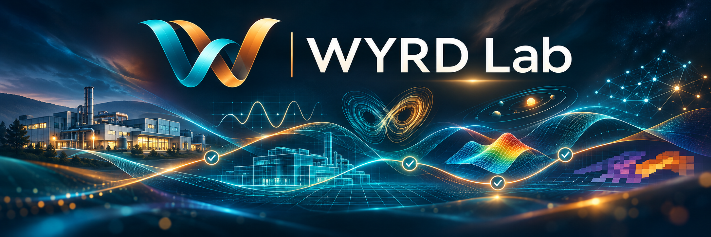

  

# WYRD Lab: WEAVE Your Research & Development

**W**orkflows for **E**ngineering, **A**nalysis, **V**irtualization & **E**xperimentation.

- Open-source tools for engineering, modeling, simulation, visualization, and experimentation.
- Building reusable, modular, extensible, and interoperable tools that work independently and become more powerful when connected.
- Focused on reusable software that connects computational models, physical systems, data, and digital environments—making complex systems easier to understand, test, and explore.

*Build independently. Connect meaningfully. Explore freely.*
